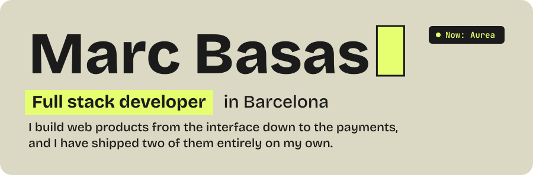
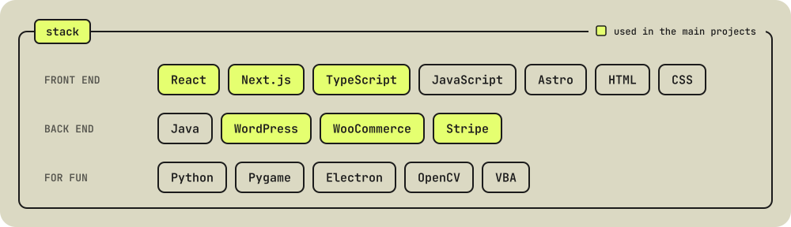

  

Before this I spent two years at NTT DATA: one building Java microservices, one building React and TypeScript interfaces from design files.

## Now

Building the web app at [Aurea](https://www.aurea.gg) with React and Next.js. I focus on the front end, and I also work on actions, queries and ingestions when needed.

## Built solo

| Project | What it is | Built with |
| --- | --- | --- |
| [**WP Verifactu**](https://wpverifactu.com) | Invoicing for Spanish WooCommerce stores. A WordPress plugin and a [web platform](https://app.wpverifactu.com/) that issue invoices with a QR code and send them to the AEAT, the Spanish tax agency, as Verifactu requires. | `WordPress` `WooCommerce` |
| [**Bodina**](https://www.mybodina.com) | A wedding gift list where couples create their own funds and guests contribute by card. Payments go straight to the couple's bank account. Built end to end, from the first sketch to the live payments. | `Stripe` |

## Smaller work

| Project | What it is | Built with |
| --- | --- | --- |
| [**Pep Bové Instal·lacions**](https://marcbasas.github.io/Pep_Bove_instalacions_web/) · [source](https://github.com/MarcBasas/Pep_Bove_instalacions_web) | Website for an electrical, plumbing and heating installer in Igualada. Bilingual in Catalan and Spanish. | `Astro` `TypeScript` `MapLibre` |
| [**Kumo Creative Project**](https://kumocreativeproject.com) | Website for a video production company, made to work on every screen size. | `HTML` `CSS` `JavaScript` |
| [**Constellations**](https://www.marcbasas.com/games/Constelations/build/web/index.html) · [source](https://github.com/MarcBasas/Constelations_pygame) | Points drift across the screen and connect when they get close. Compiled to WebAssembly, so it runs in the browser. | `Python` `Pygame` |
| [**Widget Calendari**](https://github.com/MarcBasas/widget_calendari) | A Windows desktop widget that shows the whole year as a pixel-art calendar. | `Electron` `JavaScript` |
| [**Multimedia Converter**](https://github.com/MarcBasas/Multimedia_Conversor) | A Windows app that converts images, video and audio, in batches. Ships as a single executable. | `Python` |
| [**Camera in Excel**](https://github.com/MarcBasas/Camera_Excel) | Your webcam, drawn live inside an Excel sheet by repainting cell colors from Python. | `Python` `OpenCV` |
| [**ChessExcel**](https://github.com/MarcBasas/ChessExcel) | A full chess game that runs inside an Excel workbook. | `VBA` |

## Stack

## Get in touch

&nbsp;

